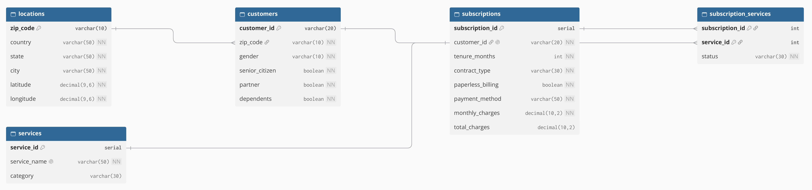

# Telecom Customer Churn: Relational Database (PostgreSQL)

Splits one flat table (`staging_customers`, 7,043 rows) into five related tables in third normal form.

## Tables
`locations` -> `customers` -> `subscriptions` -> `subscription_services` <- `services`

## Files
| File | Content |
|---|---|
| `01_create_and_load.sql` | Drops and creates the 5 tables, then loads them from `staging_customers` |
| `02_view_tables.sql` | Row counts and queries that show every table |
| `Telco_Database_Report.pdf` | Report: ERD, mapping, normalization, validation |
| `erd.png`, `mapping.png` | Diagrams |

## How to run
1. Load the original dataset into PostgreSQL as a table named `staging_customers`.
2. Run `01_create_and_load.sql`.
3. Run `02_view_tables.sql`.

Expected counts: customers 7,043, subscriptions 7,043, services 9, subscription_services 63,387.

## Notes
- `staging_customers` is only read, never changed.
- Dropped columns: `count`, `lat_long`, `churn_value` (redundant).
- 11 subscriptions have `total_charges = NULL` (customers not billed yet in the source).
